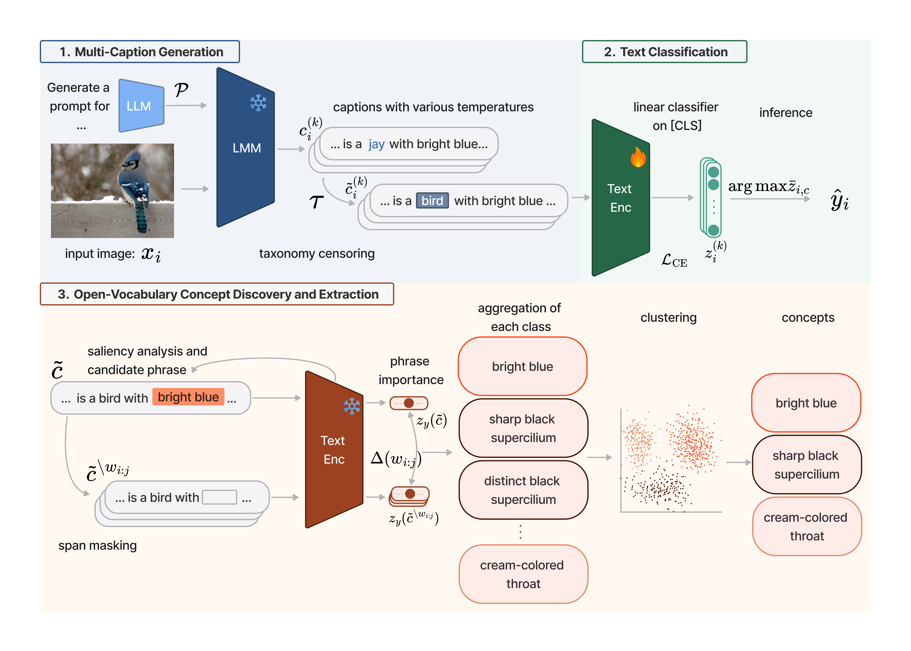

# CaBM — Caption Bottleneck Models

<p align="center">
  <a href="https://arxiv.org/abs/2607.00578"><strong>Paper</strong></a>
  &nbsp;|&nbsp;
  <a href="https://github.com/bariscagliyan/CaptionBottleneckModels"><strong>Code</strong></a>
</p>

<p align="center">
  <strong>Seref Baris Cagliyan</strong> &nbsp;·&nbsp;
  <strong>Umut Ozdemir</strong> &nbsp;·&nbsp;
  <strong>Merve Tapli</strong> &nbsp;·&nbsp;
  <strong>Emre Akbas</strong>
</p>

<p align="center">
  <em>Accepted to ECCV 2026</em>
</p>

<p align="center">
  
</p>

<p align="center">
  <em>Overview of CaBM: multi-caption generation with taxonomy censoring, text-only classification, and post-hoc open-vocabulary concept discovery.</em>
</p>

CaBM is the official implementation of the paper
[**Caption Bottleneck Models**](https://arxiv.org/abs/2607.00578), accepted to
**ECCV 2026**.

CaBM performs image recognition **entirely through text**: a frozen vision-language
model turns each image into several censored captions, a text classifier predicts the
label from those captions, and per-class **concepts** are then extracted from the trained
classifier's own behavior. Because the classifier never sees pixels, the bottleneck is
leakage-free by construction, and the discovered concepts are literal caption phrases.

The pipeline is three independent steps:

1. **`generate_captions.py`** — image → K censored captions
2. **`train_classifier.py`** — captions → text classifier
3. **`extract_concepts.py`** — captions + classifier → per-class concepts with importance scores

Each step reads/writes plain files, so you can run them separately, on different machines,
or in parallel. Defaults reproduce the paper setup.

## Install

```bash
pip install -r requirements.txt
```

## Data format

Provide images in either form:

- **Folders** (default): `--data-root ROOT` where images live in `ROOT/<class_name>/<image>`.
- **Manifest**: `--manifest file.jsonl` with one `{"image": "path", "label": "class_name"}`
  per line (`--image-root` is prepended to relative paths).

Class names are taken from the folder/label and are what gets censored.

---

## Step 1 — Generate captions

```bash
python generate_captions.py \
    --data-root data/cub/train \
    --prompt prompts/cub_fine_grained.txt \
    --output captions/cub_train.jsonl
```

Writes one JSON line per image: `{"image", "label", "caption_1", ..., "caption_K"}`.

- `--prompt` (**required**) is your captioning prompt. The prompt should instruct the model
  **not** to name the class and to describe only visible attributes. The paper's prompts are in
  `prompts/`: `cub_fine_grained.txt`, `flowers102.txt`, `food101.txt`, `cifar10.txt`,
  `cifar100.txt`, `imagenet.txt`, plus a `generic_coarse.txt` template to adapt for a new dataset.
  Each follows the same structure: strict "do-not-name" rules first, then an attribute checklist.
- **Captioner defaults:** `--model Qwen/Qwen3-VL-2B-Instruct`,
  `--temperatures 0.7,0.9,1.1,1.3,1.5` (⇒ K=5 captions), `--top-p 0.95`,
  `--repetition-penalty 1.08`, `--no-repeat-ngram-size 3`, `--min/max-new-tokens 40/300`.
- **Censoring (on by default):** the dataset's **class names** are removed from captions and
  replaced with `--replacement-token` (default `subject`). Comma/semicolon-separated synonyms
  in a label are each matched, and plural forms are handled.
  Additional group/family terms are supplied via
  `--censor-terms file.json` — they are **not** guessed from the class names, so the same
  mechanism works for any dataset (CUB, ImageNet, …). See `examples/censor_terms.example.json`.
  Disable class-name censoring with `--no-censor-class-names`.
- **Scale-out:** run with `--num-shards N --shard-id i` (0..N-1) to caption in parallel;
  concatenate the resulting files.
---

## Step 2 — Train the text classifier

```bash
python train_classifier.py \
    --train-captions captions/cub_train.jsonl \
    --test-captions  captions/cub_test.jsonl \
    --output-dir runs/cub
```

The model is a transformer encoder with a **linear head on the final-layer `[CLS]`**
representation; at test time per-caption logits are **averaged** (logit voting).
Saves the checkpoint, `label_mapping.json`, `config.json`, and (if `--test-captions`
is given) `test_metrics.json`.

**Validation:** pass an existing split with `--val-captions val.jsonl`; if omitted, a
class-stratified `--val-split` fraction (default `0.1`) is held out from the training images.

**Defaults:** `--model-name roberta-base`, `--max-length 512`, `--epochs 30`,
`--batch-size 16 --grad-accum 3` (effective 48), `--lr 2e-5`, `--weight-decay 0.05`,
`--warmup-ratio 0.06`, cosine schedule, `--label-smoothing 0.1`,
`--early-stopping-patience 6`, plus layer-wise LR decay `--llrd-factor 0.85`,
`--freeze-layers 2`, and light train-only text augmentation
(`--word-dropout 0.1 --span-dropout 0.03 --aug-prob 0.3`). Set `--llrd-factor 0`,
`--freeze-layers 0`, `--aug-prob 0` for a plain fine-tuning baseline.

---

## Step 3 — Extract concepts

```bash
python extract_concepts.py \
    --captions captions/cub_train.jsonl \
    --model-dir runs/cub \
    --output-dir runs/cub/concepts
```

For each correctly classified image, candidate caption spans are proposed from
gradient×embedding saliency and scored by **span erasure** (how much removing a span
drops the target-class logit). Spans that matter on average and consistently are kept,
then clustered into concepts.

**Output** (in `--output-dir`):

- `final_concepts.json` — `class_name -> [{"concept", "importance"}]`: one entry per cluster,
  the centroid-closest phrase and its summed erasure importance, ranked by importance.

**Defaults:** `--top-phrases-per-caption 30`, `--max-ngram 8`,
retention `--min-mean-delta 0.1 --min-positive-rate 0.60`,
clustering `--min-cluster-size 5 --min-samples 3 --merge-threshold 0.70`,
`--top-concepts 50`. Use `--max-images-per-class N` to cap work on large datasets.

---

## End-to-end example

```bash
DATA_ROOT=data/train TEST_ROOT=data/test PROMPT=prompts/cub_fine_grained.txt \
    bash examples/run_all.sh
```

## Repository layout

```
generate_captions.py   train_classifier.py   extract_concepts.py   # the three steps
cabm/captioning.py     cabm/classifier.py     cabm/concepts.py      # library
prompts/               examples/              requirements.txt
```
